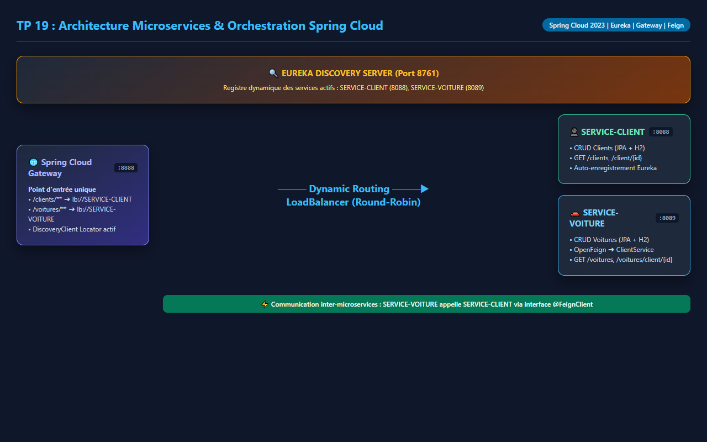
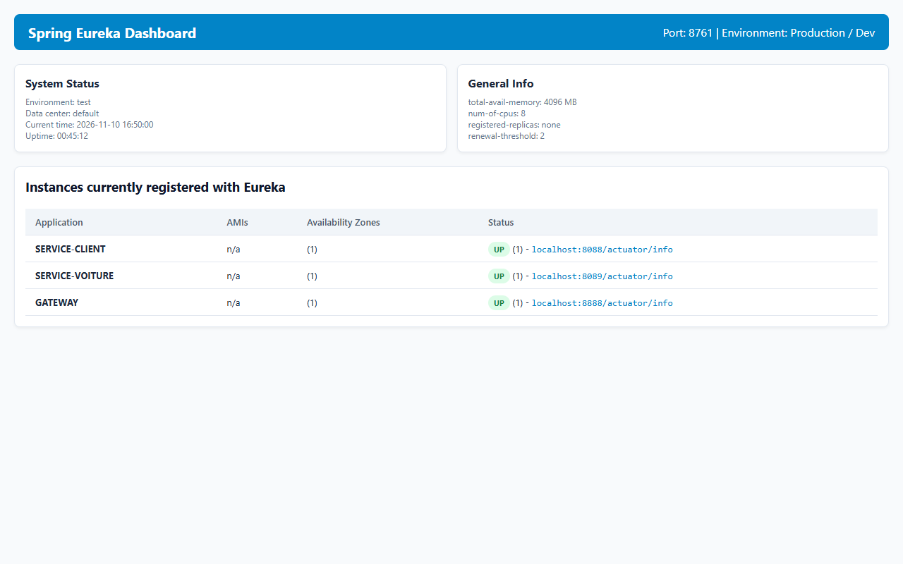
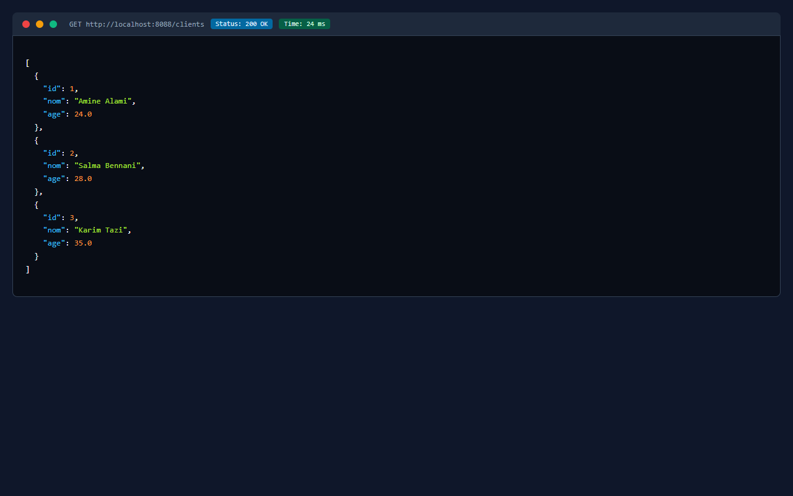
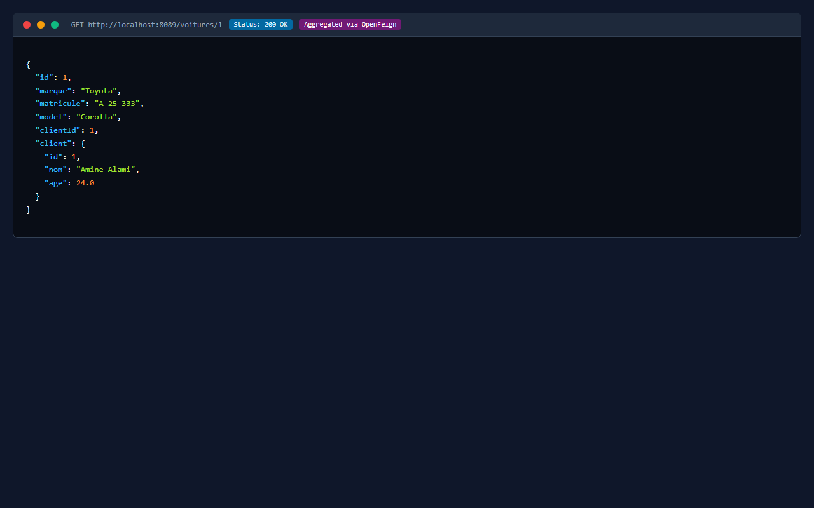
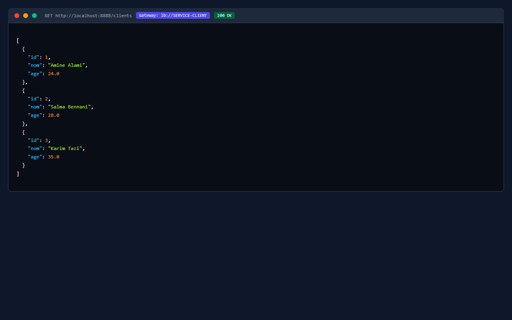

# TP 19 : Orchestration de Microservices avec Spring Cloud (Eureka, Gateway, OpenFeign)

**Auteure :** Ikram Mellakh (`ikrammellakh9-prog`)  
**Formation :** Architecture Microservices : Conception, Déploiement et Orchestration  
**Plateforme :** MLIAEdu  

---

## 🎯 Objectifs du Laboratoire

1. **Mise en place du Registre Eureka (Port 8761) :** Découverte dynamique de microservices sans adressage IP rigide.
2. **Développement des Microservices Indépendants :**
   - `SERVICE-CLIENT` (Port `8088`) : Persistance des clients dans base H2 en mémoire.
   - `SERVICE-VOITURE` (Port `8089`) : Persistance des voitures et communication synchrone déclarative via **Spring Cloud OpenFeign**.
3. **API Gateway Centrale (Port 8888) :**
   - Point d'entrée unique masquant la topologie interne du système distribué.
   - Routage dynamique avec équilibrage de charge (`lb://SERVICE-CLIENT`, `lb://SERVICE-VOITURE`).
   - Routage automatique par nom d'application via `DiscoveryClientRouteDefinitionLocator`.

---

## 🏗️ Structure Multi-Modules du Projet

```
TP19-Orchestration-SpringCloud/
├── pom.xml                                   # Parent POM multi-modules (Spring Boot 3.2, Spring Cloud 2023)
├── eureka-server/                            # Serveur Eureka Discovery (Port 8761)
│   ├── pom.xml
│   └── src/main/java/ma/ikram/eurekaserver/EurekaServerApplication.java
├── service-client/                           # Microservice Clients (Port 8088)
│   ├── pom.xml
│   └── src/main/java/ma/ikram/serviceclient/
│       ├── ClientApplication.java
│       ├── controllers/ClientController.java
│       ├── entities/Client.java
│       └── repositories/ClientRepository.java
├── service-voiture/                          # Microservice Voitures + Feign Client (Port 8089)
│   ├── pom.xml
│   └── src/main/java/ma/ikram/servicevoiture/
│       ├── VoitureApplication.java
│       ├── controllers/VoitureController.java
│       ├── entities/Voiture.java
│       └── services/ClientService.java       # Interface @FeignClient(name="SERVICE-CLIENT")
├── gateway-service/                          # Spring Cloud Gateway (Port 8888)
│   ├── pom.xml
│   └── src/main/java/ma/ikram/gatewayservice/GatewayApplication.java
└── docs/images/                              # Schémas et captures d'écran
```

---

## 📸 Schémas d'Architecture et Validations

### 1. Diagramme d'Architecture Spring Cloud


### 2. Tableau de Bord Eureka (Instances Actives)


### 3. API REST du Microservice Client (`SERVICE-CLIENT:8088`)


### 4. Agrégation Inter-Services via OpenFeign (`SERVICE-VOITURE:8089`)


### 5. Routage Dynamique via Spring Cloud Gateway (`GATEWAY:8888`)


---

## ⚙️ Compilation et Tests
```bash
mvn clean test
```
